<picture>
  <source media="(max-width: 600px) and (prefers-color-scheme: dark)" srcset=".github/assets/hero-mobile-dark.svg">
  <source media="(max-width: 600px)" srcset=".github/assets/hero-mobile-light.svg">
  <source media="(prefers-color-scheme: dark)" srcset=".github/assets/hero-dark.svg">
  
</picture>

<picture>
  <source media="(max-width: 600px) and (prefers-color-scheme: dark)" srcset=".github/assets/rule-mobile-01-dark.svg">
  <source media="(max-width: 600px)" srcset=".github/assets/rule-mobile-01-light.svg">
  <source media="(prefers-color-scheme: dark)" srcset=".github/assets/rule-01-dark.svg">
  
</picture>

Ghost Channel hides a link, a short text or a small file in whatever a screen is showing. It adds a
faint, fast colour flicker to the picture. A phone camera on a web page is meant to read it back.
Sender and receiver are both static web pages: no app, no backend, no accounts.

It is a working prototype. It has been tested in a camera simulator and in desktop browsers feeding
the sender's own canvas to the receiver. It has never been tested with a phone pointed at a screen,
and nobody has yet measured whether people can see the flicker.

Live site: https://hesselb20-ctrl.github.io/ghost-channel/

<picture>
  <source media="(max-width: 600px) and (prefers-color-scheme: dark)" srcset=".github/assets/rule-mobile-02-dark.svg">
  <source media="(max-width: 600px)" srcset=".github/assets/rule-mobile-02-light.svg">
  <source media="(prefers-color-scheme: dark)" srcset=".github/assets/rule-02-dark.svg">
  
</picture>

**The problem.** A QR code works, but it takes space on the screen and everyone sees it. Data can also
ride on the picture itself as a temporal flicker. A screen refreshes at 60 Hz or more; a phone camera
records at 30 fps. A fast flicker that is hard to see is too fast for the camera to sample cleanly.

**What was missing.** Research prototypes such as HiLight, InFrame and Uber-in-Light ran as native
apps. This project tries the same idea with both ends in an ordinary browser: a carrier chosen so a
30 fps camera still recovers it, error correction for a noisy channel, and a receiver that finds the
screen without markers.

**Who it is for.** Anyone presenting a screen to people with phones: a slide, a video or a shared
screen that also carries a link or a file. That use case is the design target. No one has used it yet.

Derivation and the alternatives that were rejected: [`DESIGN.md`](DESIGN.md) sections 1 and 2.

<picture>
  <source media="(max-width: 600px) and (prefers-color-scheme: dark)" srcset=".github/assets/rule-mobile-03-dark.svg">
  <source media="(max-width: 600px)" srcset=".github/assets/rule-mobile-03-light.svg">
  <source media="(prefers-color-scheme: dark)" srcset=".github/assets/rule-03-dark.svg">
  
</picture>

<picture>
  <source media="(max-width: 600px) and (prefers-color-scheme: dark)" srcset=".github/assets/flow-mobile-dark.svg">
  <source media="(max-width: 600px)" srcset=".github/assets/flow-mobile-light.svg">
  <source media="(prefers-color-scheme: dark)" srcset=".github/assets/flow-dark.svg">
  
</picture>

1. **Pack.** The payload (link, text or file) goes into a container with its own CRC-32. It is cut
   into blocks. Each packet carries a 6-byte header, one fountain-coded block and a CRC-32, then
   Reed-Solomon parity over GF(256). The Reed-Solomon and fountain code are written for this project.
2. **Modulate.** The picture is split into a grid of cells. Each cell gets a 2×2 checker of opposite
   signs, multiplied by a 20 Hz carrier. The carrier's phase carries the data: QPSK, two bits per
   cell per 200 ms symbol. Some cells are pilots with a known phase.
3. **Keep it faint.** By default the change runs along the blue-yellow axis with luminance held
   constant, scaled to the local pixel value (typically 1 to 4 %). On a 60 Hz panel one carrier cycle
   is three frames whose weights sum to zero, so the time average is the original picture.
4. **Capture.** A 30 fps camera cannot follow 20 Hz, but it records it as a 10 Hz beat with both
   quadratures intact. Frames go to a Web Worker and are reduced to a luma and a chroma plane.
5. **Find and lock.** The screen is found where carrier power stands out from the residual, with no
   markers. Corners can also be placed by hand. The grid is locked by checker energy and confirmed
   by the pilots, then symbol timing is found.
6. **Demodulate and correct.** A least-squares fit per cell gives DC, in-phase and quadrature; the
   pilots give the phase reference. Reed-Solomon with erasures, CRC-32 and the fountain decoder
   rebuild the object.
7. **Show.** A link is shown in full and opens in a new tab only when tapped. Only `http` and `https`
   links get a button. A file is offered as a download with a neutral content type.

<picture>
  <source media="(max-width: 600px) and (prefers-color-scheme: dark)" srcset=".github/assets/rule-mobile-04-dark.svg">
  <source media="(max-width: 600px)" srcset=".github/assets/rule-mobile-04-light.svg">
  <source media="(prefers-color-scheme: dark)" srcset=".github/assets/rule-04-dark.svg">
  
</picture>

What the code does today.

- **Sender page.** WebGL2 renderer over a demo scene (slide, aurora, portrait, dark), an image or
  video file, a webcam or a shared screen. Optional badge that tells viewers the screen carries data.
  `src/send`
- **Receiver page.** Camera pipeline, Web Worker, markerless screen detection, manual corners, a
  diagnostics panel and a self-test that runs sender and receiver inside one tab. `src/receive`, `src/core/rx`
- **Codecs.** CRC-32, Reed-Solomon with errors and erasures, fountain code (carousel up to 8 blocks,
  LT code above), packet framing, payload container. `src/core`
- **Presets.** Six: `far`, `standard`, `dense`, `fast` (needs a real 60 fps camera), `export` (10 Hz,
  for recorded video, visible) and `hfr` (40 Hz, for 120 Hz displays). The receiver tries them all. `src/core/presets.ts`
- **Blind A/B test.** A page that finds the amplitude at which a viewer can no longer tell a
  modulated clip from a clean one. `src/abtest`
- **Landing page.** Its hero picture broadcasts a demo message. `src/landing`
- **Simulator.** Display and rolling-shutter camera model, plus the experiment scripts behind
  RESULTS.md. `src/sim`
- **Deployment.** A workflow that tests, builds and publishes the static site to GitHub Pages.
  `.github/workflows/pages.yml`

Net rates per preset, from `npm run sim:presets` (no loss, no acquisition delay):

| Preset | Grid | Carrier | Symbol | Net rate |
|---|---|---|---|---|
| `far` | 12×7 | 20 Hz | 200 ms | 340 bps |
| `standard` | 16×9 | 20 Hz | 200 ms | 620 bps |
| `dense` | 24×14 | 20 Hz | 200 ms | 1680 bps |
| `fast` | 24×14 | 20 Hz | 100 ms | 3360 bps |
| `export` | 12×7 | 10 Hz | 400 ms | 73 bps |
| `hfr` | 16×9 | 40 Hz | 200 ms | 620 bps |

Measured results, from [`RESULTS.md`](RESULTS.md):

| Measure | Result | Source |
|---|---|---|
| Sweep trials that recovered the payload, white slide | 101 of 168 | `SIM` |
| Same, talking-head stand-in | 80 of 168 | `SIM` |
| Payloads delivered that differed from what was sent | 0 | `SIM` |
| 61-byte link at 0.4 m, colour axis 2 % and 4 % | `standard` 1.7 s, `dense` 0.5 s, `far` 3.3 s | `SIM` |
| 32 KB file, receiver joins at a random point, `dense` | 156.9 s and 157.4 s, file intact | `SIM` |
| `standard` at 4 % colour through H.264 | survives CRF 18, lost at CRF 23 | real codec, no camera |
| Browser self-test, sender canvas into receiver | decodes in desktop Chrome and an embedded Chromium pane | desktop only |
| Phone pointed at a screen | not done | `REAL` |
| Whether people can see it | not measured | `REAL` |

Known limits, from the repository's own docs:

- Never run on a phone. The simulator leaves out the camera's temporal noise reduction, demosaicing,
  moiré, focus hunting and OLED PWM.
- The amplitude at which the flicker becomes invisible is unknown. The blind test page exists; nobody
  has taken it.
- 2 m at 720p: 0 of 24 sweep cells decoded. One separate run with `far` at 8 % brightness did.
- Dark content carries little signal. The colour axis needed 8 %, or shadow boost, on a dark scene.
- Room light flickering at 100 Hz often makes automatic screen detection pick the room. Placing the
  corners by hand worked in the simulator.
- A faint colour signal does not survive ordinary video compression. `export` does, but it is visible.
- The 20 Hz carrier is inside the range that matters for photosensitive epilepsy. The visible debug
  mode shows a seizure warning and asks for confirmation first.

<picture>
  <source media="(max-width: 600px) and (prefers-color-scheme: dark)" srcset=".github/assets/rule-mobile-05-dark.svg">
  <source media="(max-width: 600px)" srcset=".github/assets/rule-mobile-05-light.svg">
  <source media="(prefers-color-scheme: dark)" srcset=".github/assets/rule-05-dark.svg">
  
</picture>

Requires Node 22.18 or newer (`engines` in `package.json`). Commands below were run in a clone of
this repository on Windows 11 with Node 26.13.0 and npm 11.20.0. They were not tested on macOS or Linux.

```bash
npm ci
```

Installs without errors. npm warns that the `esbuild` install script was not approved; the steps
below still worked.

Run the tests. Expect `25 passed` after about 30 seconds.

```bash
npm test
```

Type-check and build the static site into `dist/`.

```bash
npm run build
```

Start the dev server. Here it was started on port 5179; `npm run dev` runs the same `vite` command
on its default port. `/`, `/send/`, `/receive/` and `/abtest/` all answered with HTTP 200.

```bash
npx vite --port 5179
```

Print the preset table.

```bash
npm run sim:presets
```

Not run here: the receiver's self-test in a browser, any phone test, and the simulator experiments
(`sim:model`, `sim:sweep`, `sim:join`, `sim:codec`, `sim:micro`, `sim:one`; `sim:codec` needs
`ffmpeg`). Browsers give camera access only on `https://` pages or `localhost`. The dev server
switches to HTTPS when `.cert/cert.pem` and `.cert/key.pem` exist, and accepts `*.trycloudflare.com`
host names (`vite.config.ts`). The live site above is already served over HTTPS.

<picture>
  <source media="(max-width: 600px) and (prefers-color-scheme: dark)" srcset=".github/assets/rule-mobile-06-dark.svg">
  <source media="(max-width: 600px)" srcset=".github/assets/rule-mobile-06-light.svg">
  <source media="(prefers-color-scheme: dark)" srcset=".github/assets/rule-06-dark.svg">
  
</picture>

**Stack**

| Layer | Built with |
|---|---|
| Language | TypeScript, no runtime libraries |
| Sender rendering | WebGL2 shader, with a CPU twin in `src/core/modmath.ts` |
| Receiver | Camera APIs, Web Worker, WebGL2 or Canvas 2D downscale |
| Build and tests | Vite 6, Vitest 2 |
| Hosting | GitHub Pages, static files |

**Status**

| Part | State |
|---|---|
| Codecs and framing | Built. Covered by unit tests on a perfect channel. |
| Modulation and receiver | Built. Measured in the simulator with the real sender and decoder. |
| Browser plumbing | Run in desktop Chrome and an embedded Chromium pane, sender canvas fed to the receiver. |
| Live site | Deployed on GitHub Pages by the workflow. |
| Phone pointed at a screen | Not done. |
| Invisibility to people | Not measured. |

**Roadmap.** The next steps the repository lists:

1. Run the device checklist with a phone and a screen, and replace the simulator numbers.
2. Use the known homography for the phase plane instead of a free plane, to shrink the false-lock margin.
3. Track global motion between grid re-locks, for handheld use at a distance.
4. Once locked, process only the screen region at native camera resolution.
5. Soft-decision decoding in place of hard-decision Reed-Solomon with erasures.
6. Content-adaptive amplitude: more signal where texture masks it.
7. WebCodecs export with explicit frame rate and bitrate, and a re-filmed codec plus camera test.

**Documents**

| File | Contents |
|---|---|
| [`DESIGN.md`](DESIGN.md) | Scheme, rejected alternatives, frame format, receiver pipeline, presets, simulator, open questions |
| [`RESULTS.md`](RESULTS.md) | Every measured number, labelled by source |
| [`results/raw/`](results/raw) | Raw output of the experiment scripts |

<picture>
  <source media="(max-width: 600px) and (prefers-color-scheme: dark)" srcset=".github/assets/rule-mobile-07-dark.svg">
  <source media="(max-width: 600px)" srcset=".github/assets/rule-mobile-07-light.svg">
  <source media="(prefers-color-scheme: dark)" srcset=".github/assets/rule-07-dark.svg">
  
</picture>

MIT. See [`LICENSE`](LICENSE).
